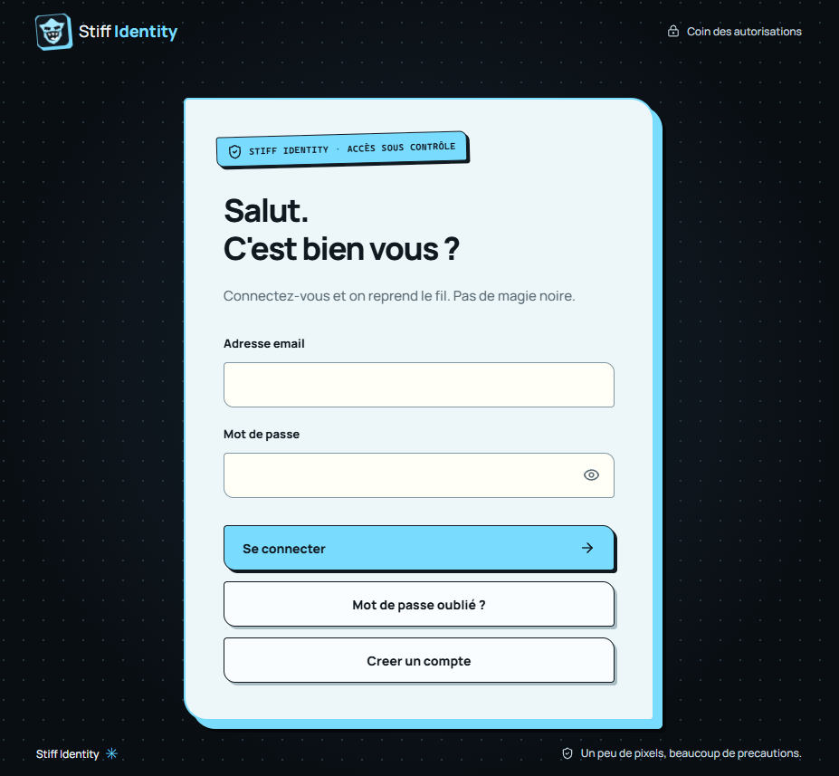

# Stiff Identity

Frontend de connexion et de consentement pour un fournisseur d'identite Supabase OAuth Server. Vue 3, TypeScript et Vite ; publication statique sur GitHub Pages avec domaine personnalise.



## Demarrage

Prerequis : Node >= 22.22.2 et npm.

```powershell
npm ci
Copy-Item .env.example .env.local
```

Renseigner l'URL HTTPS Supabase et la cle publique `sb_publishable_...` dans `.env.local`, puis :

```powershell
npm run dev
```

La route `/oauth/consent/?authorization_id=...` est appelee par Supabase, pas directement avec un identifiant invente. Sans configuration ou demande valide, l'interface affiche une indisponibilite explicite.

## Commandes

- `npm run check` : lint, tests et compilation.
- `npm test` : tests automatises sans reseau Supabase.
- `npm run build` : generation de `dist/`, dont `oauth/consent/index.html` et `update-password/index.html`.
- `npm run preview` : servir le resultat compile localement.
- `npm audit` : controle des dependances.

## Documentation

- [Index documentaire](docs/README.md) et [decisions techniques](docs/adr/README.md).
- [Fonctionnalites et perimetre V1](docs/fonctionnel.md).
- [Configuration Supabase et GitHub Pages](docs/exploitation.md).
- [Securite et limites](docs/securite.md).
- [Regles permanentes pour les IA](AGENTS.md).

Les comptes et les emails d'inscription et de récupération sont gérés par Supabase ; aucun secret de serveur ni backend n'est inclus. La récupération de mot de passe se fait depuis la mire de connexion et aboutit à la page statique `/update-password/`. MFA n'est pas inclus. Une session est persistée par le SDK dans le navigateur du fournisseur pour la continuité SSO ; consulter les limites de sécurité avant mise en production.